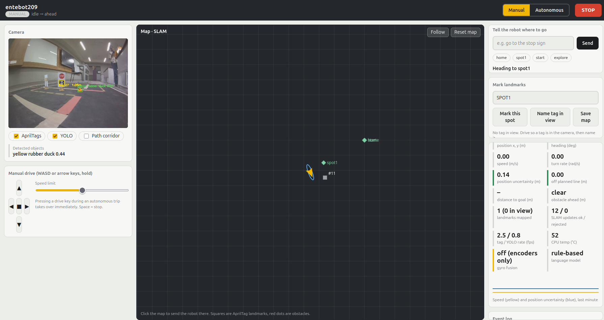
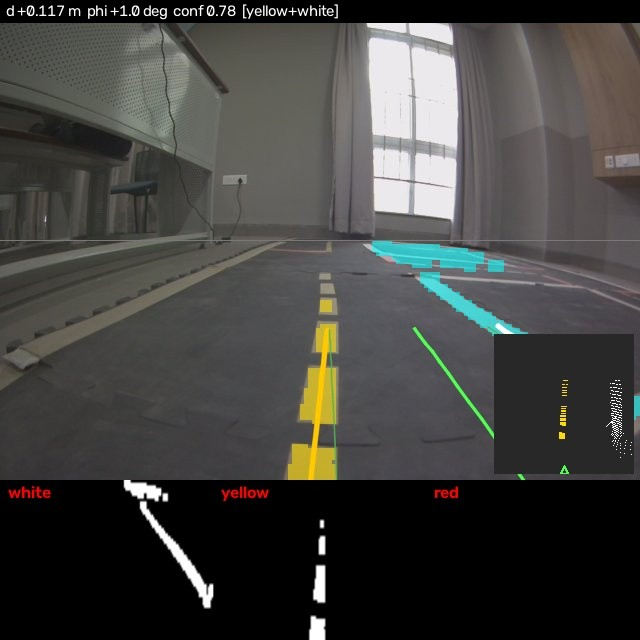
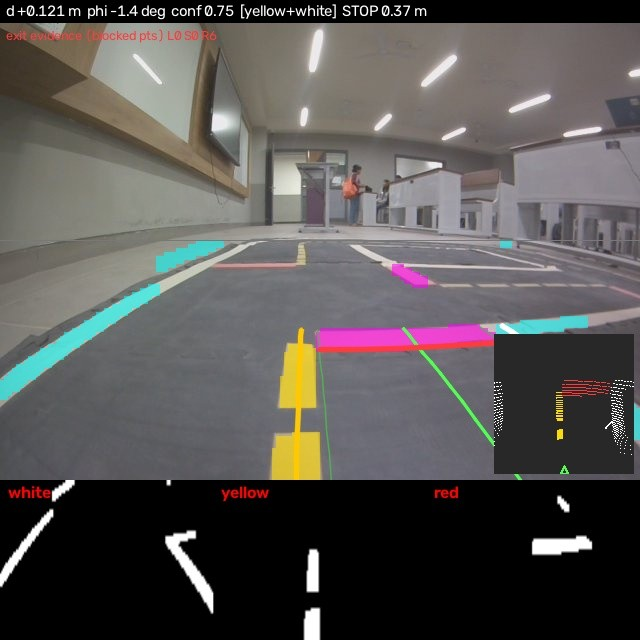
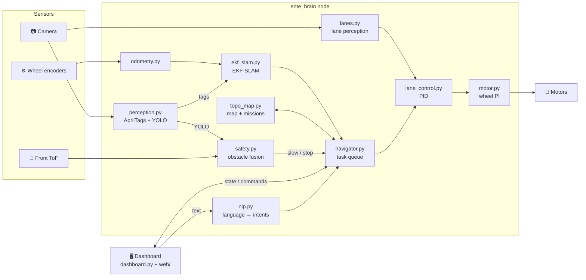

<div align="center">

# 🦆 ente_nav

### Autonomous navigation for the Duckietown DB21 Duckiebot

Lane following · Intersection handling · EKF‑SLAM · YOLO obstacle detection · Natural‑language commands · Live web dashboard


-F5C518)




<sub><i>The ente_nav dashboard running on the robot at <code>http://entebot209.local:8090</code>: camera with AprilTag + YOLO detections, live SLAM map, language commands and telemetry.</i></sub>

</div>

---

## 📑 Contents

- [Overview](#-overview)
- [Features](#-features)
- [See it in action](#-see-it-in-action)
- [Architecture](#-architecture)
- [Repository layout](#-repository-layout)
- [Getting started](#-getting-started)
- [Talking to the robot](#-talking-to-the-robot)
- [Configuration](#%EF%B8%8F-configuration)
- [Tools & tests](#-tools--tests)
- [Model notes](#-model-notes)

---

## 🔭 Overview

**ente_nav** is a single ROS node (`ente_brain`) that runs on a Duckiebot and turns it into a self‑driving robot you can steer from a browser or with plain English. It plugs into Duckietown's [`dt-core`](https://github.com/duckietown/dt-core) as an extra package and runs alongside the standard drivers.

It was built and tuned on **entebot209**, a DB21 on a Jetson Nano. Nothing about the track layout is hard‑coded: the robot learns the map while it drives.

## ✨ Features

| | Feature | What it does |
|---|---|---|
| 🛣️ | **Lane following** | HSV masks for the white edge, the yellow dashed centre line and the red stop lines are projected onto the floor. The robot's lateral offset `d` and heading error `phi` are fitted from them and fed to a PID controller with curvature feed‑forward, drift recovery and line‑loss handling. |
| 🚦 | **Intersections** | Stops at red lines, checks which exits (left / straight / right) are open, then drives an encoder‑guided arc through the junction. |
| 🗺️ | **Topological map** | Learns stop lines as nodes and the roads between them as edges while driving. Places you save become routable goals. The map persists across restarts. |
| 📍 | **EKF‑SLAM** | Uses AprilTags as landmarks to correct wheel‑odometry drift, with a χ² outlier gate and a relocalisation spin when uncertainty grows too high. |
| 🦆 | **Obstacle safety** | Combines YOLO11n detections inside the lane corridor with the front time‑of‑flight sensor. It slows down, then hard‑stops, and resumes only after the path stays clear. A sensor that stops reporting is treated as an obstacle, never as clear. |
| ⚙️ | **Closed‑loop motors** | PI control of each wheel's speed from the encoders, with static‑friction compensation and stall protection. The DB21 motors stall below ~0.25 duty, so open‑loop control isn't good enough. |
| 💬 | **Natural language** | Accepts commands like *"go to the kitchen"* or *"turn right 30 degrees"*. It uses the [Cactus Needle](https://pypi.org/project/cactus-needle/) on‑device model when available and a rule‑based parser otherwise. The model only proposes an intent; the node validates it and executes it. |
| 🖥️ | **Web dashboard** | A Flask app with an MJPEG camera feed, a clickable SLAM map, WASD manual drive, landmark naming, telemetry and an emergency **STOP** button. |

## 🎥 See it in action

<table>
<tr>
<td width="50%" align="center"><br><b>Lane following</b><br><sub>Yellow centre line + white edge locked (<code>conf 0.78</code>), with the colour masks below and a bird's‑eye view inset.</sub></td>
<td width="50%" align="center"><br><b>Approaching an intersection</b><br><sub>Red stop line detected <b>0.37 m</b> ahead (magenta) while exit evidence is collected.</sub></td>
</tr>
</table>

<sub>Both images are real frames from entebot209's camera, annotated by <code>tools/tune_lanes.py</code> using the same code that runs on the robot.</sub>

## 🧠 Architecture



## 📂 Repository layout

```
ente-nav/
├── install.sh                      # copies the package into a dt-core checkout
├── launchers/ente-nav.sh           # dts launcher  (-L ente-nav)
├── duckie_opset18_original.onnx    # original YOLO export (reference only, not installed)
└── packages/ente_nav/
    ├── config/ente_nav.yaml        # every tunable: geometry, speeds, HSV, PID, safety…
    ├── launch/ente_nav.launch
    ├── src/ente_brain_node.py      # the ROS node that wires it all together
    ├── include/ente_nav/           # the modules shown in the diagram above
    ├── models/duckie.onnx          # YOLO11n "yellow rubber duck" detector (opset 17)
    ├── web/index.html              # dashboard UI
    ├── tools/                      # calibration, tuning and verification scripts
    └── tests/                      # laptop tests, no ROS needed
```

## 🚀 Getting started

**Requirements:** a Duckietown DB21 Duckiebot, a laptop with the [`dts`](https://docs.duckietown.com/) shell, and a checkout of `duckietown/dt-core`.

```bash
# 1. Get the code
git clone https://github.com/Keerthana-prasad/ente-nav.git
git clone https://github.com/duckietown/dt-core.git ~/dt-core

# 2. Install ente_nav into dt-core (also adds flask, onnxruntime, pyyaml, dt-apriltags to its dependencies)
cd ente-nav && ./install.sh ~/dt-core

# 3. Build on the robot and run
cd ~/dt-core
dts devel build -H entebot209
dts devel run   -H entebot209 -L ente-nav
```

Then open **http://entebot209.local:8090**. Replace `entebot209` with your robot's name here and in `config/ente_nav.yaml`.

> [!TIP]
> Confirm the robot really drives. With ~40 cm of clear floor in front, run
> `python3 packages/ente_nav/tools/verify_motion.py entebot209.local`. It drives forward 20 cm, turns left 90° and reports **PASS** only if the encoders and the estimated pose both moved as expected.

> [!IMPORTANT]
> Measure your own robot. `lane_width`, the camera mounting (`cam_height`, `cam_tilt_deg`) and the HSV thresholds in `config/ente_nav.yaml` were tuned for entebot209 and its mat.

## 💬 Talking to the robot

Type into the dashboard's **"Tell the robot where to go"** box:

| You say | The robot |
|---|---|
| `follow the lane` | lane‑follows, handling stop lines and intersections |
| `map the track` | drives around and learns every intersection |
| `save this as kitchen` | remembers the current spot as a named place |
| `go to the kitchen` · `go home` | plans a route and drives there |
| `name the tag in view stop sign` | gives the visible AprilTag a friendly name |
| `forward 20 cm` · `turn right 30 degrees` | precise relative moves |
| `go to x 1.0 y 0.5` | drives to map coordinates |
| `explore` · `fast` · `slow` | free exploration / speed level |
| `stop` · `manual` | stops immediately / hands control back to you |

You can also click anywhere on the map to send the robot there. Hold **WASD** or the arrow keys to drive manually; this takes over instantly, even during an autonomous trip. **Space** stops the robot.

<details>
<summary><b>Optional: run the Needle language model on your laptop</b></summary>

```bash
pip install cactus-needle flask
cd packages/ente_nav/tools
PYTHONPATH=../include python3 test_needle.py     # check it works locally
PYTHONPATH=../include python3 nlp_server.py      # serves on :5005
```

Set `nlp_url: http://<laptop-ip>:5005/parse` in `config/ente_nav.yaml`. Needle runs fully offline and needs no API key. If it's unreachable, the built‑in rule parser takes over.
</details>

## 🎛️ Configuration

Everything lives in [`packages/ente_nav/config/ente_nav.yaml`](packages/ente_nav/config/ente_nav.yaml), with a comment on every value. The main groups:

| Section | Examples |
|---|---|
| Robot geometry | `wheel_radius`, `baseline`, `encoder_resolution` |
| Camera mounting | `cam_height`, `cam_tilt_deg`, `ground_scale` |
| Lane perception | HSV ranges for `white` / `yellow` / `red`, ROI, gating |
| Lane control | `v_nom`, `kd`, `kphi`, `ki`, drift and line‑loss timings |
| Intersections | `stop_target`, turn radii, `exit_block_pts` |
| Safety | `slow_dist`, `stop_dist`, `clear_time`, sensor staleness |
| Motors | `u_static`, `kp`, `ki`, stall limits |
| CPU budget | `lane_hz`, `yolo_every_n_frames`, `tag_hz` |

## 🧰 Tools & tests

| Script | Purpose |
|---|---|
| `tools/grab_frames.py` | Saves camera frames from the running robot for offline tuning |
| `tools/tune_lanes.py` | Runs the robot's lane code on saved frames, writes annotated images and suggests a `ground_scale` |
| `tools/verify_motion.py` | End‑to‑end drive check on the real robot |
| `tools/hotpatch.sh` · `restart_robot.sh` | Fast iteration helpers |
| `tests/test_sim.py` | Simulates the lane controller, intersection turns, route planner and mapping mission |
| `tests/test_lanes_synthetic.py` | Renders synthetic lane images at a known `d` / `phi` and checks perception recovers them |

```bash
cd packages/ente_nav
python3 tests/test_sim.py              # 14 tests
python3 tests/test_lanes_synthetic.py  # 4 tests
```

The tests need only `numpy`, `opencv-python` and `pyyaml`; no ROS or robot required.

## 🦆 Model notes

`models/duckie.onnx` is the `best.onnx` from **lx-object-detection-ente** (YOLO11n, class: *yellow rubber duck*). It was converted from opset 18 to **17** so the robot's onnxruntime 1.12.1 can load it. dt-core pins `numpy<=1.21.5`, so onnxruntime can't be upgraded on the robot. The converted model's outputs are bit‑identical to the original. The original export is kept at the repo root as `duckie_opset18_original.onnx` for reference.

To detect other objects, add your own model under `yolo_models:` in the config. Class names are read from the ONNX file itself.

---

<div align="center">
<sub>Built for Duckietown by <a href="https://github.com/Keerthana-prasad">@Keerthana-prasad</a> · runs on <b>entebot209</b> 🦆</sub>
</div>
